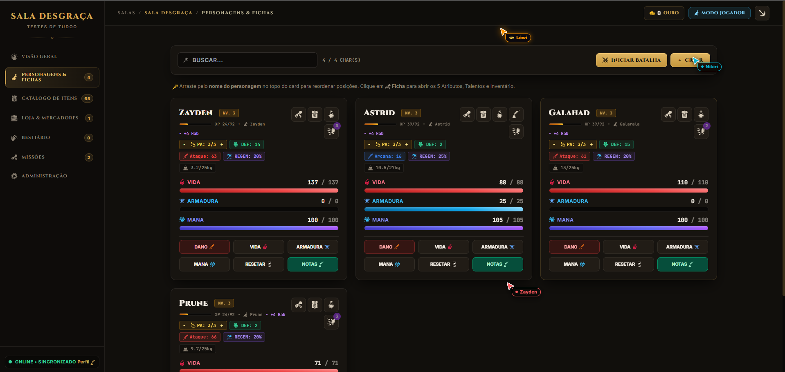

# CMrpg — Sistema de Mesa Virtual e Gerenciamento de Campanha

O **CMrpg** é uma aplicação web para gerenciamento de sessões de RPG de mesa em tempo real, reunindo tabuleiro tático, fichas de personagens, árvores de habilidades, economia, inventário, combate e controle de permissões em um único ambiente sincronizado entre Mestre e Jogadores.

  

---

## Como Iniciar e Conectar Jogadores

### Para o Mestre (Host)

1. Baixe e instale o [Radmin VPN](https://www.radmin-vpn.com/br/).
2. Crie uma rede privada no Radmin VPN com nome e senha e compartilhe esses dados com o grupo.
3. Execute o arquivo **`iniciar_servidor.bat`** na pasta principal do projeto:
   - Use as setas do teclado para escolher entre **Iniciar** ou **Instalar atualizações e iniciar** (que verifica e baixa a versão mais recente do GitHub automaticamente).
   - O inicializador configura o ambiente automaticamente e exibe o seu endereço IPv4 do Radmin VPN (formato `26.x.x.x`).
4. O navegador abrirá automaticamente em `http://localhost:8000` com acesso de Mestre.
5. Envie o endereço de rede aos jogadores no formato `http://26.XX.XX.XX:8000`.

### Para os Jogadores

1. Baixe e instale o Radmin VPN.
2. Entre na rede privada criada pelo Mestre (**Rede -> Entrar em rede existente**).
3. Abra qualquer navegador e acesse o endereço enviado pelo Mestre (`http://26.XX.XX.XX:8000`).

---

## Guia de Funcionalidades e Como Usar

### 1. Visão Geral da Sala e Membros
- **Convite e Endereço da Sala:** Exibe o link direto para copiar e enviar aos jogadores conectados na mesma rede.
- **Lista de Membros Conectados:** Mostra todos os participantes online, o personagem vinculado a cada um e em qual aba cada jogador está navegando no momento.
- **Apelidos, Cores e Permissões:** O Mestre pode clicar no botão de configuração ao lado de qualquer membro para definir um apelido, vincular um personagem, escolher a cor do cursor daquele jogador e configurar suas permissões individuais.
- **Cursores Colaborativos:** Cada participante visualiza em tempo real o cursor e o nome dos demais jogadores na tela.
- **Alternância de Modo (Mestre / Simular Jogador):** No canto superior direito, o Mestre pode alternar para a visualização de jogador comum para testar permissões e visualizar a interface exatamente como os jogadores veem.

---

### 2. Mesa (Tabuleiro Tático)
- **Movimentação Livre e Colisão:** Arraste fichas de personagens e inimigos livremente pelo tabuleiro (`4800 x 3000 px`). As fichas não se sobrepõem e respeitam os limites da área.
- **Câmera e Zoom Individuais:**
  - Use a roda do mouse para aproximar ou afastar (`25%` a `150%`) focado na posição do cursor.
  - Segure `o botão do meio do mouse` para mover a câmera.
  - Use os botões **Centralizar** e **Ver Tudo** na barra superior para enquadrar rapidamente os participantes.
  - A câmera e o zoom de cada jogador são individuais e não alteram a tela dos demais.
- **Modo Compacto (Tokens):** Cada card na Mesa pode ser alternado entre exibição completa ou token circular compacto (exibindo nome e nível para personagens, e apenas nome para inimigos).
- **Trazer Inimigos:** Pelo botão **Trazer Inimigo**, o Mestre seleciona criaturas do Bestiário para inserir diretamente na Mesa.
- **Combate na Mesa:** Ao clicar em **Iniciar Batalha**, a Mesa organiza automaticamente os inimigos na parte superior e os personagens na parte inferior, exibindo a barra de ordem de turnos.

---

### 3. Fichas de Personagens
- **Criação e Edição de Personagem:**
  - Defina nome, nível, imagem (com ferramenta de recorte circular para token e visualização da imagem completa ao clicar na foto), **Raça**, **Sub-raça**, **Classe** e **Subclasse**.
  - Distribua os pontos nos **5 Atributos Base** (Força, Destreza, Constituição, Inteligência e Sabedoria) e acompanhe o recálculo automático de Vida, Armadura, Mana, Defesa, Ataque, Regeneração e Capacidade de Peso.
- **Gerenciamento em Tempo Real:**
  - Ajuste rapidamente Pontos de Ação (`PA`), Vida, Armadura, Mana e Experiência (`XP`) diretamente pelos botões rápidos do card ou dentro da ficha detalhada.
  - O sistema aplica subida de nível automaticamente ao atingir o XP necessário, concedendo novos pontos de atributos e talentos.
- **Painel de Resistências e Acúmulos:**
  - Configure e acompanhe as 7 resistências (Físico, Mágico, Pyro, Cryo, Elétrico, Profano e Sacro) e os limites máximos de 7 condições de status (Sangramento, Veneno, Chamas, Congelamento, Choque, Atordoamento e Corrupção).
- **Habilidades Gerais e Ressurreição:**
  - Cadastre habilidades rápidas próprias diretamente na ficha.
  - Caso a vida chegue a zero, o botão de ressuscitar permite restaurar o personagem conforme as regras da mesa.

---

### 4. Árvore de Habilidades, Classes e Raças
- **Árvores de Habilidades:**
  - O Mestre (ou jogador autorizado) cria árvores personalizadas, define o **Efeito de Árvore Completa (100%)** e cadastra nós divididos em 4 categorias: **Passivas**, **Talentos**, **Ativas** e **Supremas**.
  - Cada nó pode ter custo em pontos, múltiplos níveis de melhoria (ranks), modificadores automáticos de atributos, descrição e metadados de combate (Custo de Mana, Custo de PA, Usos, Recarga e **Cargas** para Supremas).
  - **Painel Radial em 4 Quadrantes:** Ao abrir a árvore na ficha, o jogador visualiza o progresso percentual no círculo central e navega pelas 4 categorias. Clicar em um nó abre o painel lateral para liberar, melhorar, reembolsar pontos ou ativar/desativar passivas (respeitando o limite máximo de **3 passivas ativas** simultâneas por ficha).
- **Classes e Subclasses:**
  - Reutiliza a estrutura em 4 quadrantes das árvores, aplicando um **Efeito de Classe** imediato desde a criação do personagem.
  - A partir do **Nível 15**, o jogador pode equipar ou trocar uma **Subclasse** na edição da ficha, podendo opcionalmente substituir 1 efeito de classe e herdar 1 habilidade de outra classe. Ao trocar de subclasse, os pontos gastos na anterior são devolvidos automaticamente.
- **Raças e Sub-raças:**
  - O Mestre pode cadastrar raças e sub-raças com bônus automáticos de atributos, pontos de talento extras e traços descritivos aplicados na criação da ficha.

---

### 5. Combate e Fila de Turnos
- **Ordem de Iniciativa:** Ao iniciar uma batalha, a barra de turnos exibe a ordem dos combatentes. O Mestre pode reordenar a fila arrastando os participantes e avançar os turnos.
- **Aplicação de Dano:** O botão **Dano** abre a janela de cálculo onde se escolhe o atacante, o alvo, o valor base e o tipo de dano (Físico, Mágico ou Elemental), descontando automaticamente resistências e armadura.
- **Acúmulos de Status:** Aplique acúmulos nos combatentes; efeitos contínuos (como dano por turno ou perda de ação) são processados na passagem de turnos.
- **Buffs e Nerfs:** Crie efeitos temporários (com duração em turnos) ou permanentes, com múltiplos modificadores fixos ou percentuais, e ative ou desative cada efeito individualmente com um clique.

---

### 6. Catálogo de Itens, Inventário e Loja
- **Catálogo de Itens:**
  - O Mestre cadastra itens com nome, categoria (Arma, Armadura, Consumível, Acessório, Item-Chave, etc.), peso, valor padrão, imagem, descrição e modificadores automáticos quando equipado.
- **Inventário do Personagem:**
  - Organizado por abas de categoria e controle de peso máximo da mochila.
  - Permite equipar/desequipar itens (aplicando os bônus na ficha na hora), usar consumíveis, transferir itens entre personagens e gerenciar o ouro no cofre.
  - Em **Administração**, o Mestre pode habilitar o modo de **Carteira Compartilhada** (ouro único para todo o grupo) ou **Inventário Ilimitado** (sem restrição de peso).
- **Loja e Mercadores:**
  - O Mestre cria mercadores (NPCs) e define quais itens do catálogo cada um vende, com estoque e preço personalizado.
  - Os jogadores podem comprar itens diretamente ou clicar em **Fazer Proposta** para enviar uma oferta de preço personalizado, que fica disponível no botão **Solicitações de Compras** para o Mestre aceitar ou recusar.
  - Os jogadores também podem solicitar a venda de itens do próprio inventário pelo sistema de venda assistida (**Solicitar Venda**), aguardando aprovação do Mestre.

---

### 7. Bestiário e Quadro de Missões
- **Bestiário:**
  - Biblioteca de criaturas e inimigos do Mestre com atributos, resistências, habilidades e imagem própria. Permite clonar modelos e enviá-los rapidamente para a Mesa em qualquer quantidade.
- **Quadro de Missões:**
  - O Mestre cria missões com título, descrição, status e recompensas em Ouro, XP e Itens.
  - Jogadores podem aceitar missões disponíveis e o Mestre pode concluir e entregar as recompensas individualmente ou em lote para todo o grupo.

---

### 8. Bloco de Notas da Ficha
- Cada personagem possui um bloco de notas próprio com suporte a múltiplas páginas nomeadas, formatação de texto (negrito, itálico, listas, cores e destaque) e salvamento automático conforme você digita.

---

### 9. Administração, Histórico e Desfazer/Refazer
- **Desfazer e Refazer:** Na barra lateral esquerda, os botões **Desfazer** e **Refazer** permitem reverter ou reaplicar ações recentes realizadas na sala.
- **Configurações da Campanha:** Permite ajustar regras de progressão, carteira compartilhada e limite de peso do inventário.
- **Histórico de Auditoria:** Registra todas as ações importantes da sessão (alterações de vida, compras, transferências de itens, mudanças de permissão e recompensas) para consulta do Mestre.
